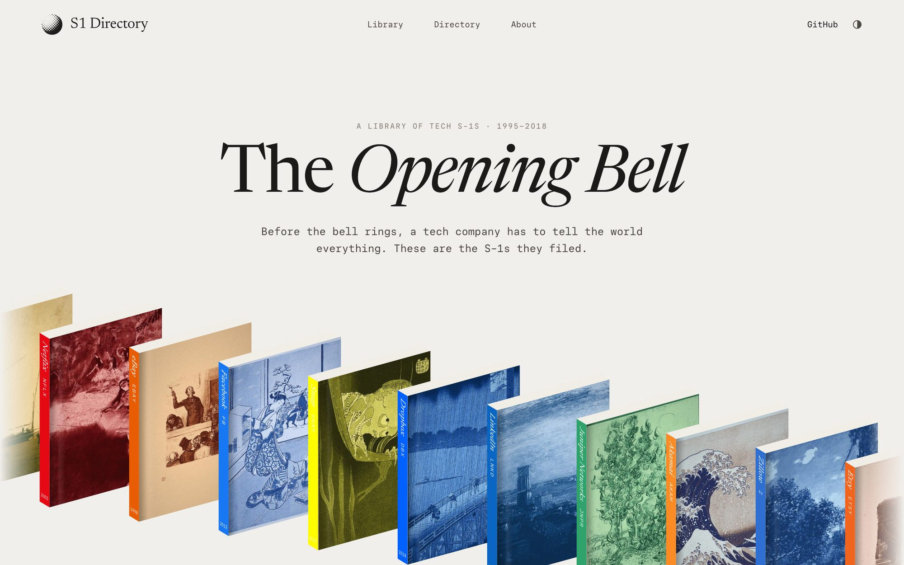
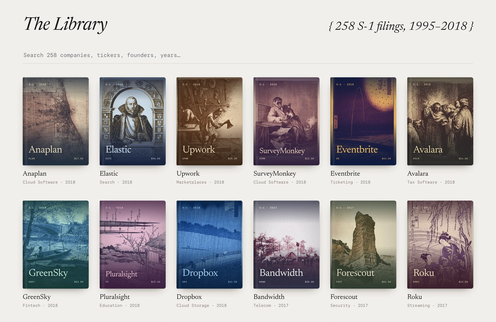
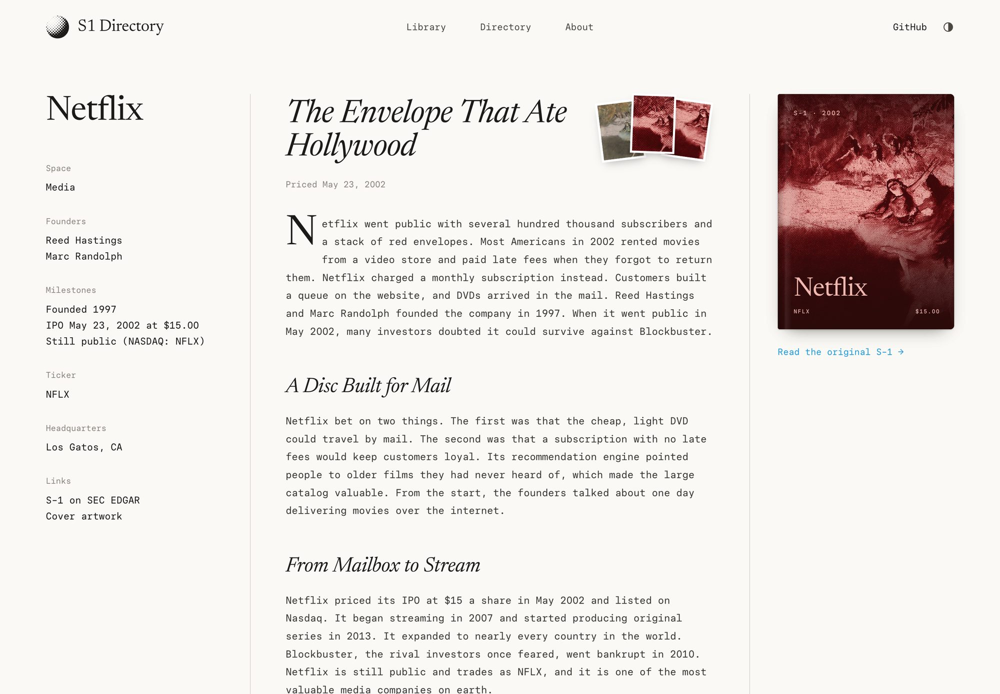
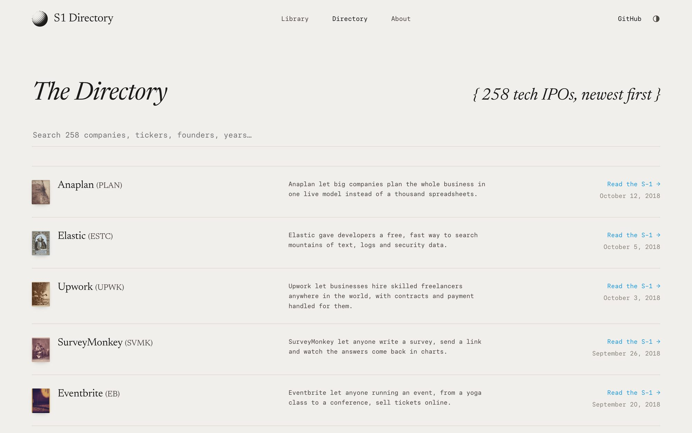

<p align="center">
  <a href="https://www.s1directory.com"></a>
</p>

<h1 align="center">S1 Directory</h1>

<p align="center">
  <em>The Opening Bell.</em> A library of tech S-1s, bound as books.<br>
  <a href="https://www.s1directory.com"><strong>www.s1directory.com</strong></a>
</p>

<p align="center">
  <a href="https://www.s1directory.com">
    <picture>
      <source media="(prefers-color-scheme: dark)" srcset="docs/hero-dark.jpg">
      
    </picture>
  </a>
</p>

Before a company goes public, it files an S-1 with the SEC. The S-1 says what the company does, how it makes money, and what could sink it. Investors can sue over a false line, so it is the most honest thing most companies ever write about themselves.

S1 Directory collects 258 of them, from tech IPOs between 1995 and 2018. Each filing is a book. Each book has a cover made from a public-domain artwork picked for the company's story, a short essay, and a link to the original filing on SEC EDGAR.

## The library

Every cover is a real artwork from the [Art Institute of Chicago](https://www.artic.edu/open-access) open-access collection, printed with a halftone screen in two colors. Amazon is a river. Netflix is a Degas stage. Akamai is Hokusai's Great Wave. No two books share an artwork.

<p align="center"></p>

## The books

Open a book to read its essay: what the company bet on, how the IPO went, and where the company is today. The sidebar lists the founders, the milestones, and the links to the filing.

<p align="center"></p>

## The directory

The directory lists every filing, newest first, with one line on each company and a link to the S-1. Type to search names, tickers, founders, cities and years.

<p align="center"></p>

## Details

- **Books open.** Each cover sits on a hinge, with a miniature S-1 title page underneath. Hover a book and the cover lifts. Click it and the cover swings open before the page turns.
- **Light and dark.** The site follows your system setting. The toggle in the nav switches it.
- **Type.** [Newsreader](https://fonts.google.com/specimen/Newsreader) for titles and [Paper Mono](https://github.com/paper-design/paper-mono) for everything else.
- **No framework.** The site is plain HTML, CSS and a small script, built by one Python file and served by GitHub Pages.
- **Reduced motion.** If your system asks for less motion, the animations turn off.

## Run it locally

```sh
python3 -m venv .venv
.venv/bin/pip install -r site-src/requirements.txt
.venv/bin/python site-src/build.py          # writes the site into the repo root
.venv/bin/python -m http.server 8765        # open http://localhost:8765
```

The build only re-renders covers that changed. Run `site-src/build.py --covers` to render all of them again. The first full render downloads the source artworks, which takes a few minutes.

## Add new IPOs

```sh
.venv/bin/python site-src/tools/discover.py --write   # find new tech IPOs on EDGAR, add them to filings.json
.venv/bin/python site-src/tools/pending.py --limit 20 # list filings that still need a book
```

`discover.py` reads the final prospectuses (424B4) on EDGAR. It keeps first-time IPOs in tech sector codes and skips SPACs and companies that were already public. Write the essays and pick covers by following [`WRITER_BRIEF.md`](site-src/WRITER_BRIEF.md) and [`COPY_BRIEF.md`](site-src/COPY_BRIEF.md), then build. [`ROUTINE.md`](site-src/ROUTINE.md) describes the weekly job that does this and opens a pull request for review.

## Layout

```
site-src/
  build.py            builds every page, cover and the sitemap
  filings.json        one row per S-1: name, date, ticker, price, EDGAR link
  entries*.json       essays and cover choices for each filing
  static/             style.css, app.js, Paper Mono
  tools/treat.py      the halftone print effect for covers
  tools/discover.py   finds new IPOs on EDGAR
index.html, directory/, about/, s1/<company>/, covers/   generated output
```

## Credits

- Made by [Sharan Jhangiani](https://sharanjhangiani.com) ([X](https://x.com/sjhangiani12), [LinkedIn](https://linkedin.com/in/sharanjhangiani)).
- Filings: [SEC EDGAR](https://www.sec.gov/edgar).
- Cover art: [Art Institute of Chicago](https://www.artic.edu/open-access), public domain (CC0). Each page credits its artwork.
- Fonts: Newsreader and Paper Mono, both under the SIL Open Font License.
- Design: inspired by [Chapter One](https://chapterone.com), whose library of founder stories set the look for this one.
- The essays are short summaries, not investment advice. If you spot an error, [open an issue](https://github.com/sjhangiani12/s1directory.com/issues).
